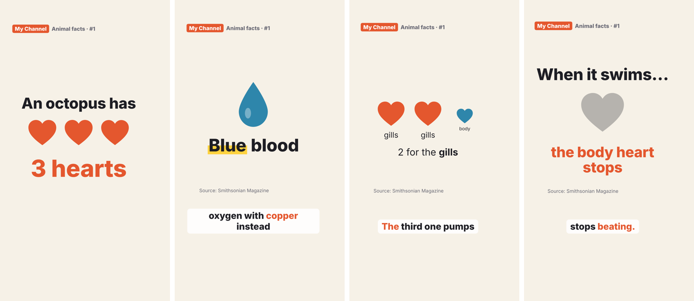

# reel-kit

**Make your own Reels, Shorts and TikToks by chatting with an AI.** You don't need to know how to code or install anything by hand: you talk, the AI does the technical part.

You get:

- 🎙️ **A voice**: a free computer voice, or your own recorded on your phone
- ✏️ **Animations that appear exactly when each word is said**
- 💬 **Subtitles** burned in, for people watching without sound
- 🖼️ **A cover picture** for your profile
- 🎨 **Your own style**: colours, fonts and vibe, which you choose by chatting (or by sending a screenshot of a video you like)

Everything is free and stays on your project. No extra accounts, no paid voices.

---

## What you need

- **A GitHub account** (free): <https://github.com/signup>. This is where your project lives.
- **An AI assistant that can work on a project** (it needs to read files and run things, not just chat). Some ideas are below. Many of them need a paid plan; **ask an adult** before signing up for anything.

> 👋 **If you're under 18:** do the setup with a parent or another adult. Most apps require you to be at least 13 to post.

---

## Step 1: Make your own copy

1. Go to this repository on GitHub.
2. Click the green **Use this template** button → **Create a new repository**.
   *(If you don't see that button, click **Fork** instead.)*
3. Give it a name (for example `my-reels`) and click **Create**.

Now you have your own copy where all your videos will be saved.

---

## Step 2: Open it with an AI assistant

Pick **one** of these two ways.

### Option A: in your browser (nothing to install) ⭐ easiest

Use an AI coding assistant that runs on a website and connects to GitHub, for example **Claude Code** on the web, **OpenAI Codex**, **Google Jules**, or a similar tool.

1. Sign in to the assistant and connect your GitHub account when it asks.
2. Choose your copy (`my-reels`).
3. Type: **"Set me up"**

That's it. The first time it takes a few minutes. Your finished videos will appear in the **`videos`** folder of your GitHub project, and you can download them from there, even on your phone.

### Option B: on your computer

1. Install **VS Code**: <https://code.visualstudio.com>
2. Add an AI assistant to it. In VS Code, open the chat (the speech-bubble icon) and sign in to **GitHub Copilot** (it has a limited free plan to try; a paid plan works better for whole videos). Other AI extensions work too (Cline, Continue, …), as do AI editors like Cursor. Use any AI model you like.
3. Get your project onto your computer: install **GitHub Desktop** (<https://desktop.github.com>), sign in, then **File → Clone repository** and pick your copy.
4. In VS Code: **File → Open Folder** and choose that folder.
5. In the AI chat, switch to **Agent** mode and type: **"Set me up"**

The assistant will install what's missing (it may ask permission to run things: say yes). On some computers installing needs an adult's password. Your videos will be in the **`videos`** folder.

*Comfortable with a terminal?* Terminal assistants like Claude Code or Grok Build work great too: open them in the project folder and say "Set me up".

---

## Step 3: Create your style (just chat)

When setup finishes, the assistant will offer to create your style. It asks a few questions, like what your videos are about, the vibe you want, and the name of your channel.

The easiest way: **send it a screenshot** of a video or account whose look you like. It will pick up the colours and mood (it won't copy anyone's logo).

It shows you a picture of your style, and you just say what to change:

> *"I like it, but darker."*
> *"Can the font be rounder?"*
> *"Make the highlight colour green."*

Then you pick a voice: it makes a few short samples and you choose the one you like. Your style is saved, and every reel will use it. You can change it any time: *"Let's change my style."*

---

## Step 4: Make a reel

Every reel goes like this. You only talk; the assistant does the rest.

| You say | The assistant |
|---|---|
| **"I want a reel about…"** *(or paste a script you already wrote)* | Helps you find a strong first sentence and write a short script (20–45 seconds). Checks the facts. **Waits for your OK.** |
| *(nothing, or)* **"I want to use my own voice"** | Makes the computer voice. Or asks you to record yourself on your phone, reading each line with a short pause, and send it the file. |
| **"What could we show on screen?"** | Suggests simple drawings, numbers and text for each part, and builds them. |
| **"Show me a preview"** | Makes a quick version for you to watch. |
| **"The title is too small"** · **"The heart comes in too late"** | Fixes it and shows you again. |
| **"Looks good, make the final"** | Makes the full-quality video and cover, plus ideas for your caption. |

Then post it! When the app asks for a cover, choose the **first frame**. It was made to be your cover.

### Handy things to say any time

- *"Where are we?"*: what's done and what's next
- *"Show me my style"*
- *"Let's continue my reel about…"*
- *"Make it shorter"* / *"Give me three other hooks"*
- *"Save my work"* (in the browser option, this saves it to GitHub)

---

## Good habits

- ✅ **Check your facts.** The assistant adds sources; keep them in your caption.
- 🎵 **Music:** only use music you're allowed to use. Songs from the radio aren't free to use.
- 🔒 **Stay private:** no full name, school or where you live in your videos.
- 🙋 **Ask before posting** if you're under 18.

---

## Works with any AI

All the instructions for the assistant are in [`AGENTS.md`](AGENTS.md), a file that most AI coding tools read automatically (there are small pointer files for the ones that look elsewhere). So you can use whichever AI you have, and switch later.

Curious how it works inside, or want to run the commands yourself? See the [technical guide](docs/technical.md).

---

## License

The code is MIT (see `LICENSE`). It's built on [Remotion](https://www.remotion.dev), which is free for individuals and small teams; check [its license](https://www.remotion.dev/license) if a company uses it. The free voice is [Kokoro](https://github.com/hexgrad/kokoro) (Apache 2.0).
